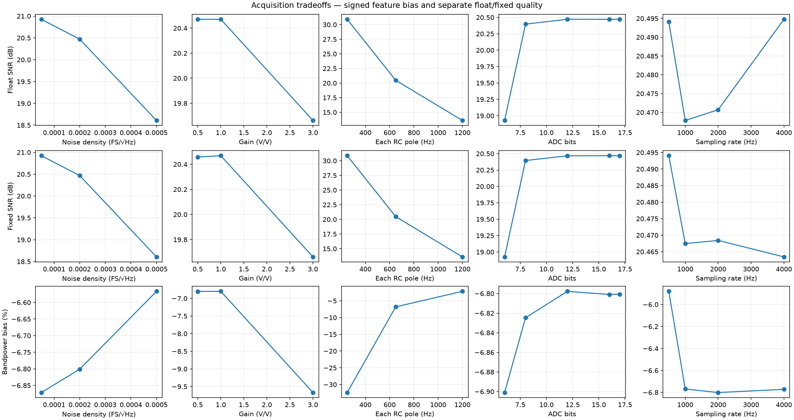
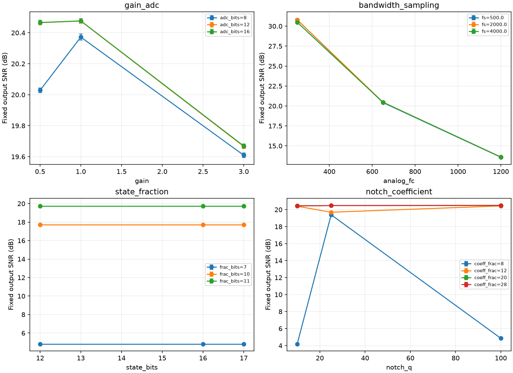
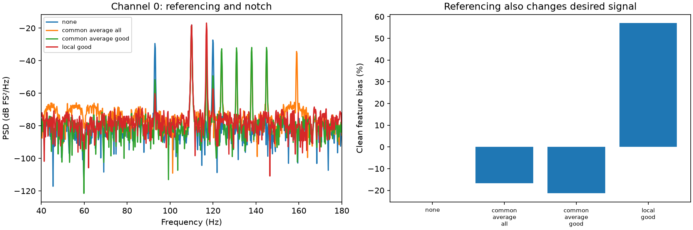

# Neural acquisition-chain engineering report

Independent educational model • schema 2 • generated from checked experiment outputs.
This report does not characterize Precision Neuroscience hardware.

## Question and method

Where is information lost, and when does additional numerical precision help?
The C model separates clean signal, AFE noise, interference, ideal ADC rounding,
ADC overload, and fixed-point implementation effects. Python controls experiments,
computes explicit-reference metrics, and independently validates the DSP blocks.

Baseline: 2000 Hz ADC, 80000 Hz internal
clock, 6 s record, 650 Hz per RC pole,
noise density 0.0002 FS/√Hz.
Amplitude remains normalized; there is no device voltage calibration.

## Principal observations

1. Baseline floating output SNR is **20.471 dB**, fixed output SNR is
   **20.468 dB**. The shared clean-filtered reference excludes
   clean-path attenuation; signed raw-input feature bias is **-6.801%**.
   Clean-path feature bias alone is **-6.888%**.
2. Additional ADC precision reduces rounding error but need not improve system SNR.
   The current ADC comparison is below; conclusions apply to this input/noise/gain case.
3. Recursive fixed-point filters can retain limit cycles even when their quantized
   linear poles are stable. Higher precision reduces some errors but is not a
   universal cure for every input, realization, or rounding mode.
4. Referencing suppresses shared interference but also changes desired spatial signals.
   A favorable matched-reference SNR is not proof of preserving the original signal.

| ADC bits | Rounding RMS (FS) | Float output SNR (dB) | Fixed output SNR (dB) |
| --- | --- | --- | --- |
| 8 | 0.00224376 | 20.3980 | 20.3948 |
| 16 | 8.75246e-06 | 20.4707 | 20.4684 |
| 17 | 4.40873e-06 | 20.4708 | 20.4679 |

## Noise-model correction

Old noise had constant per-internal-sample RMS while the internal rate varied
with ADC rate. This confounded noise density and sampling rate. The new model
holds a common internal rate and one-sided density, with input sigma = density ×
sqrt(Fint/2). Common seeds share actual analog sample endpoints across ADC rates.
Measured noise RMS at 500/1000/2000/4000 Hz is
0.00456208, 0.0045091, 0.00451806, 0.00453285 FS;
continuous-RC theory predicts 0.00451889 FS.

Normalized Hann PSD and integrated power replace the old unnormalized FFT sum.
Full-band SNR, in-band SNR, signed feature bias, and clean-path gain/phase are
reported separately. These metric definitions prevent one good number from
concealing a different distortion. Details: [model and metrics](MODEL_AND_METRICS.md).

## Validation performed

**14 test groups passed**, with no reported errors or failures.
Test results establish the stated numerical contracts for selected vectors and
parameter ranges; they do not validate a physiological model or a product.
Machine-readable evidence: [validation.json](validation.json).

| Validation | Measured evidence | Interpretation |
| --- | --- | --- |
| Float reference | Max error 5.36e-15 FS | C agrees with SciPy for tested random streams |
| Fixed reference | 24 format/mode combinations, exact equality | Independent Python arbitrary-integer oracle |
| Block state | 1, 17, 64, 1024 samples; irregular final block | Same sample output regardless of block size |
| Analog convergence | Max tone gain error 6.38e-05 | 40/80/160 kHz versus continuous two-pole transfer |
| Noise calibration | Theory RMS 0.00451889 FS | Measured noise agrees within explicit finite-record tolerance |
| Error closure | Max residual 1.19e-14 FS | Waveforms reconstruct; powers retain cross terms |
| PSD normalization | Even/odd Parseval and tone power checks pass | FS²/Hz PSD; FS² integrated power |
| ADC boundaries | Code transitions, ties, overload, error decomposition | Rounding and clipping have separate contracts |
| Saturation recovery | Float 0.474 s; fixed 2.324 s | Observed last deviation >0.001 FS from unclipped-control output |

Impulse-followed-by-zero behavior, measured over the last 2 s of an 8 s vector:

| State bits | Zero-input tail RMS (FS) |
| --- | --- |
| 8 | 0 |
| 16 | 0.000469603 |
| 17 | 0.000234769 |

These are observations for one excitation and format. The 8-bit result being zero
is not evidence that 8 bits is more accurate; coarse arithmetic can erase the
small response while causing larger errors during an active signal. The validation
suite records these outcomes rather than forcing a misleading zero-tail assertion.

## Experiment coverage and uncertainty

acquisition: 18, interactions: 117, numerical: 96, notch_stress: 18, monte_carlo: 120 rows.
Interaction runs pair common seeds, with 3 repeats.
Summary files contain sample SD, SEM, and empirical 5th/95th percentiles.
These intervals are descriptive, not manufacturing yields or confidence bounds.
Plots show means ± one sample SD for repeated interactions.

Monte Carlo separates parameter-only, noise-only, and combined variation.
The independent log-normal priors are unbounded, hypothetical, and explicitly
saved. Coefficient precision, accumulator width, rounding, overflow, realization,
line offset/drift/harmonics/steps, and artifact stress are covered in separate tables.
Fixed-filter pole radius is saved, including unstable/marginal choices; numerical
failures are evidence, not silently discarded configurations.

## Illustrative numerical requirements

[experiment_spec.json](experiment_spec.json) defines an editable demonstration
screen, not an employer requirement: fixed SNR ≥ 18 dB,
SNR loss versus float ≤ 0.1 dB,
implementation RMS ≤ 0.001 FS,
absolute fixed feature bias ≤ 10%,
stable quantized poles, and no analyzed fixed-point overflow events.
**18/96** tested numerical configurations pass this baseline-only screen.

| Coefficient fractional bits | Accumulator bits | Rounding | Overflow | Realization | Bit-count proxy |
| --- | --- | --- | --- | --- | --- |
| 16 | 32 | nearest | saturate | df1 | 186 |
| 16 | 32 | nearest | wrap | df1 | 186 |
| 16 | 48 | nearest | saturate | df1 | 202 |
| 16 | 48 | nearest | wrap | df1 | 202 |
| 16 | 62 | nearest | saturate | df1 | 216 |
| 16 | 62 | nearest | wrap | df1 | 216 |
| 28 | 48 | nearest | saturate | df2t | 230 |
| 28 | 48 | nearest | wrap | df2t | 230 |

The bit-count proxy is S×N + 5(C+2) + A, where S=4 for DF1 and S=2 for
DF2T. It counts conceptual active state, coefficient, and accumulator bits,
providing only a transparent comparison proxy. It does not measure silicon area, host
memory, time, power, or identify the best embedded implementation. Neither this
baseline screen nor its ranking guarantees performance over the stress suite.
Full decisions and failure reasons: [numerical_screening.csv](numerical_screening.csv).

## Multichannel and streaming demonstration

Eight channels include a flat channel and a channel with an overload artifact.
Known clean signals include a shared desired component, making reference-related
signal removal visible. The simple quality gate excludes the two injected bad
channels. Statistics below average the six good channels; rejected channels remain
in the detailed table. The C block implementation preserves separate state and
agrees with SciPy on 32 channel/mode streams within 5e-13 FS.

| Reference | Matched float SNR (dB) | Clean feature bias (%) | Original-signal error RMS (FS) |
| --- | --- | --- | --- |
| none | 9.67 | 0.00 | 0.02790 |
| common_average_all | 10.96 | -16.77 | 0.03821 |
| common_average_good | 24.32 | -21.39 | 0.03988 |
| local_good | 24.90 | 57.07 | 0.06981 |

At 64-sample blocks and 2 kHz, block collection can contribute up to
**32 ms**. Notch group delay at 93/183 Hz is
0.1824/0.0161 ms.
These are different delays, not an end-to-end latency estimate.
The reference C state structure occupies 152 bytes per channel.
Median host kernel throughput across five repeats is
2.061e+08 channel-samples/s on arm64.
It excludes I/O, referencing, transport, acquisition, and scheduling and does not
certify a worst-case embedded deadline. Input generation and file I/O are outside
the timed kernel; results include a checksum to keep processing observable.

## What remains simplified and how it affects conclusions

| Simplification | Effect on conclusion | Evidence needed next |
| --- | --- | --- |
| Two stationary desired tones | Cannot infer neural feature robustness or decoder accuracy | Recorded neural data and labeled task evaluation |
| Generic two-RC analog response | Optimal bandwidth/gain values are model-specific | Measured transfer functions, gain limits, input range |
| White input noise only | No electrode or low-frequency colored-noise behavior | Noise PSD, electrode impedance, amplifier characterization |
| Ideal ADC except quantization/clipping | Bit depth is not measured ENOB or hardware fidelity | Measured SINAD, INL/DNL, jitter, transfer curves |
| Fixed 60 Hz notch | Drift/harmonics can leak; high Q extends transients | Application requirements and comparison with tracked/adaptive methods |
| Finite simulation grid and hypothetical priors | No global optimum, yield, or rare-event guarantee | Requirements-driven grids and justified parameter distributions |
| 8 synthetic channels and simple quality gates | Referencing can remove desired shared activity | Recorded spatial covariance and validated channel rejection |
| Host kernel timing | Cannot establish embedded real-time, power, or safety margins | Target profiling, worst-case timing, full pipeline and transport |

## Reproduce and inspect

Use the environment and commands in [README](README.md). Manifests record
source hashes, configuration, binary hash, dependencies, and compiler/SDK settings.
Report generation refuses failed or source-stale validation. Original `results/`
is legacy data and is not overwritten. The two schema versions are not a paired
before/after experiment: noise settings, duration, and metric definitions changed.

Useful tables: [baseline](baseline_metrics.csv), [ADC/state comparisons](bit_comparison.csv),
[paired differences](paired_delta_summary.csv), [numerical sweep](numerical_sweep.csv),
[notch stress](notch_stress.csv), [Monte Carlo](monte_carlo_summary.csv),
[multichannel](multichannel_metrics.csv), [provenance](manifest.json).
